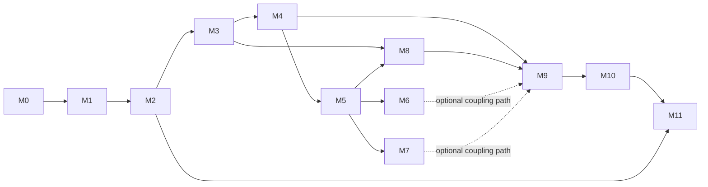

# Controlled Solar-System Dyson Cloud Laboratory

**Milestone specification — approved architecture direction; revised engineering sequence for owner review**

Prepared October 23; reconciled October 29, 2026 (DCL-PLAN-001). The bounded architecture was owner-approved October 25. This revision plans its implementation; it does not authorize the next coding task, migration, merge or deployment. Only this documentation assignment is in progress. Preserve the existing REBOUND application, interface and session-recovery contracts. Historical observations below retain their dates; they are not fresh test or operational evidence.

## 0. Reconciliation audit and controlling decisions

Authoritative development base for this planning task: `foundation/rebound-ci` at `5c57dac7671411faf0124dad5004921f88b371de`; AGENTS blob `c10d1a95e3a752f960029aa6940f7bfea084da8b`. Supported GitHub-plugin publication preserves that remote parent/tree; the clean but stale local `work` checkout at `2ae4926f391f131b2f6ab0accd89aed5b50daa4d` is excluded (24 commits behind). No simulator or dependency files change in this task.

The owner-approved architecture controls conflicting October 23 recommendations. Loop 2 is active for individually assigned, approval-gated tasks. This is not unattended scheduling or concurrent-agent authorization. Source research (loop 1), engineering correctness (2), independent model validation (3), experiments using accepted models (4), and gameplay/learning (5) remain distinct. Regression tests accompany engineering from the start; CI success neither establishes scientific validity nor authorizes release.

| Audited assumption or gap | Reconciliation / dependency |
| --- | --- |
| §4.5 treated REBOUNDx as an undecided future option; requirements still allow REBOUND 4 | Target REBOUND 5.2.2 + REBOUNDx 5.1.0, subject to project migration tests (P1). No dependency migration here. |
| Reservoir lists did not define typed inventory/journal semantics | Require per-object typed state, immutable events, independent local/global reconciliation and shared-potential/boundary conventions (§4.2, P2/P3). |
| Quiet gravity and algebraic closure could be mistaken for full validation | Separate software, numerical verification, physical validation and experimental evidence (§8); a balanced invented force remains unvalidated. |
| Universal Newtonian speed cutoffs or PN add-ons could imply broad relativity | Use intended-use error budgets and separate Newtonian/PN/SR/1PM/fixed-metric model cards (§4.6). |
| Spacecraft reference selection was missing | Basilisk 2.12.0 is an independent reference, not an automatic runtime dependency. Tudat remains an unexecuted alternative. |
| Original §9 prioritized visuals/catalog before the accounting foundation | P0–P3 establish baseline, migration evidence, typed contracts and recovery before new actuation; UI/catalog work follows stable contracts. Original M0–M11 sequence is preserved in Appendix A. |
| v0.14 described as unrecovered | Complete HTML text is now durably available in the owner's historical archive; audit its provenance before any adaptation. Historical interaction design only, not a dynamics/feasibility oracle. |
| Earlier charter/reports say approval or loop activation was pending | Later explicit owner decisions supersede those status statements; earlier evidence and failures remain historical. |
| Earlier examples select a tether/photon device | These remain candidate elementary laboratories, subject to device/model qualification; no automatic approval of capture hardware. |
| §11 automation capability observations could look current | All are dated planning history. No schedule, service, notification or unattended runner is activated by this revision. |

Approved direction does not settle packet composition/charge/speed/horizon, actuator material laws, empirical data, close-encounter fidelity, state-coupling algorithm, archive conversion policy, or redistribution rights. Resolve each before the dependent capability. Planetary bootstrap, galactic and intergalactic concepts remain future research; no implementation work for them is added.

Private approval and checkpoint records stay in Notion; this repository contains the technical plan, not copied private research notes, credentials or datasets. PR and exact-head CI evidence belong in the task checkpoint/PR after publication.


## 1. Decision summary

Build a gamified citizen-science future-civilization design sandbox around one auditable physical engine. The central player activity is to **observe → infer → design → predict → coordinate → act → measure → compare**, with conservation and engineering constraints visible throughout.

The recommended milestone outcome is a bounded, interactive Solar System laboratory: a real 3D view; Sun, eight planets, the Moon and a curated major-moon catalog; editable scenarios and ordinary massive custom bodies; resource-funded actuators and explicitly modeled coupling; limited-observation interception policies; reproducible experiments; and a first playable campaign about building and operating a solar-orbiting cloud while protecting important orbits. Successful capture is an outcome to test, not a promised capability.

Architecture direction is approved; engineering choices and each bounded implementation package still require their own acceptance and owner review:

| Decision | Recommendation | Why |
| --- | --- | --- |
| Physics authority | Target REBOUND 5.2.2 + REBOUNDx 5.1.0 after project-level tests; retain IAS15 gravity reference | Preserves moving-Sun mutual gravity, tests and recovery work |
| Application structure | Modular Python monolith and a modular browser client | Avoid premature services, billing, or infrastructure replacement |
| Visualization | Locally bundled Three.js/WebGL with float64 world coordinates and a floating render origin | Genuine 3D with reusable control/inspection behavior |
| Initial system | Sun + eight planets + independently resolved Moon, then curated major moons | Clear catalog coverage with explicit mass/ephemeris consistency |
| First actuation | Finite-propellant maneuver experiment with resolved exhaust or a validated exhaust boundary ledger | Makes momentum and energy funding concrete before autonomous control |
| First coupling | Short-range mechanical tether/damper experiment; then budgeted photon interaction | Auditable mechanisms rather than unexplained long-range attraction |
| Control development | Observe/predict-only first, single-agent manual/automatic second, coordinated policies third | Makes failure diagnosis and physical validation independent |
| Product experience | Explorer, engineering missions and research views over the same engine | Gameplay does not acquire different laws of physics |
| Persistence | Preserve SQLite, browser backups, private recovery files and deployment-key contract | No new paid service; extend state coverage rather than replace it |
| Daily work | One explicitly approved task, bounded implementation/testing, draft PR, report, then owner decision | Useful autonomy without autonomous scope growth or production changes |
| Automation | Start with existing interactive Codex + CI; separately approve scheduling/report wiring | No unconfigured promise of overnight work or morning delivery |

**Not a completion promise:** arbitrary interstellar objects cannot necessarily be captured by plausible equipment. The game must allow the scientifically correct outcome “infeasible within these resources.”

## 2. Inspected baseline and reuse inventory

### 2.1 Repository evidence

The following inspection/counts describe the October 23 design baseline. October 29 remote verification confirms merged PR #5 and the §0 base; PR #1 remains a draft from foundation/rebound-ci to main and is outside this assignment. No new production action or live-service verification is inferred.

Inspected `AGENTS.md`, `DEVELOPMENT.md`, `README.md`, both browser interfaces, `physics.py`, `server.py`, `sessions.py`, `recovery.js`, all five test/support files, recovery/evidence documentation, Git history, available branches, Issues #2/#3, PR #4 and GitHub Actions metadata.

GitHub now reports [PR #4](https://github.com/danedormio/dyson-cloud-lab/pull/4) merged into **`foundation/rebound-ci`**, at `29bb345b9409ab1533ea8308805b3fd4c4cf9de6`. That merge's application tree matches the inspected `db387fc99986196dc0721b2f37b861cca94756b3` recovery implementation. Production `main` remains `2ae4926f391f131b2f6ab0accd89aed5b50daa4d`. This inspection did not merge either branch.

The previously verified baseline is **40 tests**: 10 physics, 14 session/API, 8 recovery/migration and 8 Chromium. Both jobs passed on the PR revision; the foundation merge also has a completed successful physics/browser run. These are existing CI observations, not new tests of this proposed milestone. No milestone behavior has yet been implemented or validated.

The repository's `DEVELOPMENT.md` still contains historical statements about REBOUND installation failure and staging creation. Reconcile those with current evidence in P0a; do not treat old prose as current operational proof. The Skunkworks service name is documented, but its current URL, deployed SHA, uptime, recovery-key configuration and account privileges have not been independently verified here.

### 2.2 Reuse, adapt, replace

| Existing asset | Preserve/reuse | Required change |
| --- | --- | --- |
| `CloudWorld` / REBOUND | Mutual gravity, moving massive Sun, SI units, deterministic seeds, IAS15 reference and legacy checkpoint coordinates | Stable body IDs, arbitrary catalogs, scenario schema, attitude/resources, action and diagnostic adapters |
| Eight-cloud fix | Version-2 phase offset and finite/non-coincident population tests | Preserve old seeds as versioned fixtures; never silently regenerate saved initial states |
| FastAPI API | Session ownership, validation/error patterns and existing endpoint compatibility | Explicit scenario/run/command contracts, revision checks, idempotency, bounded prediction/control work |
| SQLite registry | Transactions, quotas, migrations and recovery-owner binding | Stop reconstructing IAS15 on every read as controlled dynamics become richer; benchmark before changing worker ownership |
| Browser recovery | IndexedDB acknowledgements, private files, signature validation, independent credential, deployment key and fault tests | Serialize controllers, reservoirs, RNG/sensors, delayed interactions and complete physical state; bound format migrations |
| `rebound.html` | Launch/reset/play/pause, tracked-object list, diagnostics, cold-start/recovery flow and shell/trail/label concepts | Extract modules; replace 2D renderer with 3D; expand controls without rebuilding familiar workflows |
| `index.html` | Launch speed/signed impact/angle, inner/outer cloud radii, trails, IDs, selection, inspection cards, pan/zoom and responsive layout ideas | Port interaction behavior onto authoritative REBOUND data; retain zero values correctly; do not copy its fixed-Sun force solver or inner-radius gravity cutoff |
| Test suite / Actions | Physics conservation, ownership, failure atomicity, recovery, real browser interactions, screenshots and CI reporting | Separate physics, UI/UX, integration and performance gates; add quantitative model tests and model-specific fixtures |
| Mission vocabulary | Cloud elements, incoming objects, effective region, tracked arrivals, shared resources | Clarify that labels are views and an “effective region” is not a guaranteed force/capture boundary |

The initial repository notes reference v0.14 idealized coupling, shared capacity, rapid-launch failures and interaction-order bias. **The original inspection did not find the full v0.14 implementation in repository history.** As of this reconciliation, the owner's historical archive supplies complete recovered HTML as machine-readable Notion text. The archive reports original raw SHA-256 `ca2092e8b4a20b759284e5fd9c75adb157e636ad40688891bf055b5c8f1a2fd3` and 44,367 UTF-8 bytes; normalized code text is not automatically byte-identical. Its HTML title says 0.12 despite the v0.14 archive label: preserve and document that discrepancy, never silently relabel source. This task confirms retrieval, not byte identity or full source validation. P0 freezes provenance/interaction inventory before refactoring. Preserve launch, selection, morphology, visibility/trail and diagnostic ideas; never port its heuristic capture forces or treat outcomes as physics regression targets.

## 3. Product specification and milestone boundaries

### 3.1 Three experiences, one physical system

**Explorer:** choose a system/epoch, rotate and inspect it, edit a private scenario, launch an object, compare trajectories and learn where model limits apply.

**Engineering missions:** a short briefing defines an objective, hardware catalog, sensor capabilities, safety constraints, deadline and finite budget. The player deploys a cloud, chooses policies and measures the result. Early missions include orbit inspection, a funded orbit change, a small formation's momentum exchange, intercept prediction, a slow-object rendezvous and a deliberately infeasible high-speed arrival.

**Research experiments:** the same system exposes initial-state provenance, parameter sweeps, uncertainty ensembles, command/event logs, convergence settings, raw diagnostics and exportable results. A research result needs a versioned manifest, reproducible evidence and review; a score or a visually impressive capture is insufficient.

Abstract construction credits, achievements and progression may simplify economics. They must never act as hidden energy, propellant, momentum, knowledge or technology. Separate credits from joules, kilograms and watts. Hardware unlocks expose explicit assumptions and validity labels; an experimental device is not presented as established engineering.

### 3.2 Civilization design and citizen science

Treat the cloud as infrastructure, not just a set of interceptors. The first campaign should expose tradeoffs among collection area, storage, propulsion, thermal rejection, sensing, communications, redundancy and protected environments. Future construction/maintenance/transport recipes extend the same material and energy inventories: manufacturing or deploying an object during a run must consume declared feedstock and energy and account for its new mass/momentum. Before that subsystem exists, design/construction occurs in a clearly labeled scenario fork, not by spawning free hardware mid-experiment.

Progression should reward resource efficiency, robustness, useful observations and explanations, not only capture count. Provide comparison experiments, hypotheses, parameter sweeps and a lab notebook alongside missions. A technology card records whether it is a validated model, ideal upper bound or speculative hypothesis. Later community contributions need provenance, consent/data-rights rules, moderation and independent replay before contributing to any scientific claim. Private experiment export is the milestone foundation; public submission/leaderboard infrastructure remains separately approved.

### 3.3 Milestone completion demonstration

An owner can open the existing Skunkworks application, select the Solar System preset, orbit the camera around an inclined trajectory, inspect the Earth–Moon system, add a custom incoming object, configure a small engineered cloud, compare a no-control prediction against a feasible funded policy, see an infeasible policy rejected, and replay/save/recover the experiment. Diagnostics show where impulse, work and waste heat went. A second visitor remains isolated.

A bounded campaign gives those tools purpose: protect an orbit, allocate resources, design a control strategy and explain the measured outcome. Players can export a sanitized experiment for review; no automatic public dataset publishing or leaderboard acceptance is included.

### 3.4 Included versus deferred

Included: resolved Newtonian Solar System models; validated non-gravitational mechanisms; finite resources; configurable scenarios; interactive 3D; single-owner experiments; limited observations; bounded coordinated policies; diagnostics; first mission pack; persistence and recovery; modular interfaces for later scales.

Deferred: star-by-star galaxy simulation, production multiplayer collaboration, automatic crowdsourced data acceptance, arbitrary user code on the server, unsupported propulsion/coupling claims, full general relativity, fluid/plasma/material simulation, commercial licensing decisions, paid persistent infrastructure and autonomous production releases. Define interfaces for future additions without pretending their physics exists.

## 4. Scientific and engineering contracts

### 4.1 Bodies, frames, units and initial conditions

- Every resolved Sun, planet, moon, cloud element, target and exhaust packet is an ordinary massive object. A cloud/target role changes control/visualization, not gravity. No planet is pinned, no planetary path is clamped and no cloud mass is discarded merely to improve performance.
- Use one authoritative inertial coordinate system per run. Store SI position/velocity internally; display AU, km and km/s with explicit conversions. Camera-relative coordinates never change physical state.
- Provide a synthetic reproducible preset and an ephemeris-derived preset. The latter records epoch, time scale, coordinate orientation, origin, source/query/version/checksum, gravitational parameters and any omitted bodies/forces. Convert UTC display time to the ephemeris time scale explicitly; do not label a synthetic epoch as observed reality.
- Recommended ephemeris source: an offline, versioned JPL Horizons/SPICE-derived bundle. Use geometric Cartesian states, not apparent/light-time-corrected positions, for Newtonian initialization. Tests must run without live network access. API querying/caching and data attribution require a small validated import tool, not a live external request per user launch.
- Resolve Sun + Mercury, Venus, Earth, Mars, Jupiter, Saturn, Uranus and Neptune + Moon first. Follow with a declared curated catalog: Phobos/Deimos, Galilean moons, Titan and selected other major Saturnian moons, major Uranian moons and Triton. Pluto/Charon and Ceres are optional dwarf-body packs, not mislabeled planets. Record exact coverage and omissions in every preset.
- **Do not double count barycenters:** independently resolved Earth + Moon require consistent component states/masses, not an Earth–Moon-barycenter mass plus another Moon. Apply the same rule to planetary-system barycenters and explicit moons. Cross-check gravitational parameters rather than combining unrelated rounded mass tables.
- User-created bodies support mass, radius/collision model, Cartesian or orbital initial conditions, reference body/frame, epoch and validated engineering parameters. Convert orbital elements once at a defined epoch. Treat parabolic and singular element cases explicitly; provide Cartesian input as the unambiguous alternative.
- Inserting/deleting/changing a body during a run is either a scenario fork or an explicit boundary flux event that accounts for mass, energy and momentum. A launch UI is not permission to claim closed-system conservation across magically added matter.
- Check mass positivity, finite values, supported speed regime, coincident/contact geometry, units, bounds and object count before committing a scenario. Current API launch limits allow speeds inappropriate for Newtonian claims; the new physical mode must warn/reject out-of-regime choices. The earlier 0.001c warning/0.01c rejection proposal is provisional historical policy, not an accepted validity envelope. Derive mission-specific limits from kinetic/momentum and gravitational approximation errors, field strength, observable tolerance and horizon before labeling a Newtonian mission validated.

A Newtonian model initialized from a high-accuracy ephemeris will subsequently diverge from that ephemeris because its force model differs. Separate integration error from model discrepancy; do not fix this by periodically resetting planetary positions.

### 4.2 Conservation and reservoirs

The physical transaction boundary must include everything needed to explain changes:

- Translational and, where modeled, rotational kinetic energy and momentum.
- Gravitational potential energy and validated elastic/coupling potentials.
- Chemical/electrical/stored energy; thermal/internal energy; propellant and expelled mass.
- Emitted/absorbed/escaping photon energy, linear momentum and angular momentum.
- Explicitly declared external energy/matter inputs and outputs when the modeled domain is open.

For a closed mechanical benchmark, total momentum and angular momentum are constant and total accounted energy is constant within the numerical error budget. For an open domain, report residuals **after subtracting signed boundary transfers**. Record angular momentum about a fixed declared inertial origin, including torque from matter/radiation flux. Camera tracking or a changing visualization origin must not alter that definition.

Energy accounting must not double count actuator work, a change in kinetic energy, exhaust energy and battery draw. Each actuator adapter declares source, sink, counterpart, work, losses and applicability. A heat ledger alone is not a thermal model: temperature needs heat capacity/state, and cooling needs a radiator/emission model and environment assumptions.

Energy/momentum carried by photons require a validated nonrelativistic radiation interface compatible with the chosen matter approximation. Do not assert exact closed Newtonian conservation while ignoring source rest-mass/energy terms. If stellar luminosity is treated as prescribed, declare and account for an open energy source and its reaction/boundary momentum instead of inventing an infinite closed-system battery.

### 4.2.1 Typed inventories and immutable transfer journal

Every physical object has a stable identity and versioned typed inventory. Quantities carry units, frame/origin/epoch where applicable, component identity and explicit modeled/unmodeled status. Distinguish dry structure, propellant, payload/feedstock and expelled/captured matter; translational state, spin/inertia/attitude; chemical/electrical stores, thermal/internal state; and emitted/in-flight radiation. Zero, unavailable and not modeled are distinct. Declare the mass convention: Newtonian material mass is not automatically a relativistic invariant/rest-energy balance. Do not count propellant both inside total body mass and again as a separate gravitating object.

An accepted transfer is append-only and auditable: schema/model version, event ID and monotone sequence, run/revision, accepted interval/time, source/destination IDs (including boundary/carrier accounts), quantity types/units/frame, signed mass/impulse/angular impulse/energy, mechanism and causal command ID, and pre/post-state references. Corrections append a reversal/superseding event; never edit past scientific evidence. A checkpoint stores journal offset/digest and inventory checksum. Hash chaining detects alteration against a trusted checkpoint; it is not independent proof of physical correctness or a signature/ownership replacement.

Independently compare measured pre/post inventories against event postings for each object and interaction, then aggregate system-wide totals. Derive audits from states/independent equations, not just summing the same journal entries that generated them. Test a wrong pair of opposite impulses that cancels globally but fails locally. Include remote noncentral impulses: linear closure alone can conceal missing carrier/spin angular momentum. Rejected trials/commands create no resource expenditure; accepted retries are idempotent and atomic.

Shared gravitational energy is an interaction account: sum each pair potential once, with an explicit diagnostic allocation convention if object views are desired. Allocated shares must sum to the pair value; assigning the full pair energy to both objects is invalid. Separate internal transfers from net external flux and external work/torque; account for insertion/removal, exhaust, photons and prescribed sources. Use a fixed inertial origin for angular momentum; model-specific energy diagnostics are required for PN or external time-dependent fields. Local mechanical energy need not be conserved individually: interaction work, flux, torque and potential exchange must explain its change.

Audit mass, all three linear/angular momentum components and energy both locally and globally. Define local scales, nonzero absolute floors and normalized tolerances before the task; do not normalize a spacecraft transfer by the Sun. Unknown heat, capture or exhaust terms block a closure claim rather than becoming an adjustable balancing entry.

### 4.3 Actuator and resource model

A cloud element can own mass/inertia/attitude, structural radius, propellant, stored energy, generator/collector, radiator, temperature limits, force/torque limits, duty cycle and efficiency curves. A preset must provide the constants needed to evaluate its mechanism; no plausible-looking default is silently certified as realizable hardware.

Actuator commands specify interval, reference frame, requested vector/torque and device. The engine enforces:

- Maximum force/torque, slew and pointing rate.
- Available propellant and conversion efficiency.
- Instantaneous power, stored-energy capacity and charging limits.
- Thermal storage/rejection and temperature limits.
- Geometry, line of sight, range, attachment and structural limits.
- The control/sensor information available at command time.

The first controlled experiment should be finite-propellant thrust. Start with a small resolved exhaust-packet benchmark that directly verifies recoil, mass and energy; then validate a bounded exhaust boundary ledger for larger simulations. The rocket equation and exhaust power/chemical-energy budget provide independent reference cases. Do not add force while leaving vehicle mass and propellant unchanged. Removing exhaust from the resolved domain is a declared boundary transfer, not deletion of an inconvenient massive object: validate its omitted gravitational effect against the stated domain/accuracy budget, or retain it. Reserve body slots and bound packet creation; an exhausted particle budget is not permission for free propulsion.

Pointing and attitude are physical state too. Use a quaternion/angular-velocity rigid-body adapter with tested inertia assumptions and torque/energy accounting when off-center forces or commanded pointing are enabled. Reaction wheels exchange angular momentum with a rotor and require energy/capacity; desaturation needs an external counterpart. Start with center-of-mass, fixed-axis thrust benchmarks to isolate translational accounting. Do not grant instantaneous unlimited body rotation or free gimbal steering to make a controller succeed.

Solar power uses declared collector area, orientation, efficiency, shadowing and distance; capacity is not generation rate. Passive solar radiation pressure and absorbed/re-emitted radiation must be modeled consistently when their effect is material, rather than charging a battery with free, momentumless power.

### 4.4 Coupling mechanisms and limits

| Mechanism | Milestone treatment | Required accounting/validation |
| --- | --- | --- |
| Mechanical tether/spring/damper | First coupling laboratory at physically short separations | Equal/opposite interaction, potential energy, damping to heat, force/strain/rate limits, finite attachment work and fracture outcome |
| Photon emission/absorption/reflection | Second coupling model for remote momentum transfer | Emitter recoil, propagation delay, target momentum, optical power, pointing, aperture/diffraction, losses, heating and escaping/re-emitted light |
| Electromagnetic/plasma interactions | Later mechanism-specific extension | Requires field/source model, reach/material properties and independent feasibility evidence; not a renamed generic attraction |
| v0.14 idealized coupling | Historical interaction-design evidence only; recovered HTML is not a physics reference | Record reported order bias/failures as motivation for independent fixtures; no automatic port or physical validation claim |

For a linear spring/damper, specify a consistent potential and dissipated power; applying a clipped force while retaining the unclipped potential is inconsistent. Turning on a tether, changing rest length or breaking it cannot create/discard energy invisibly. If collision/material behavior is not yet modeled, stop and classify the contact rather than silently merge or bounce bodies.

For light, P/c for perfect absorption and up to 2P/c for ideal normal reflection are stationary ideal limits, not a generic all-geometry thruster. Target motion, Doppler shifts, pointing, finite aperture, attenuation and heating require additional terms/assumptions. Include photon flight time and in-flight energy/momentum for long ranges. Never deliver the same energy simultaneously to multiple targets.

A useful feasibility screen: changing the momentum of a 1-kg body by 25 km/s requires 25,000 kg m/s. Ideal reflected light alone needs at least about **3.75×10¹² J** of incident optical energy. At 1 MW, its maximum ideal force is about **0.00667 N**, requiring roughly **43.4 days** of perfect alignment. The isolated body's kinetic-energy change is only 3.125×10⁸ J; these are different quantities. This is a lower-bound illustration, not a Solar System capture prediction; geometry, orbital dynamics, losses and feasible equipment generally make the task harder.

### 4.5 Integration with REBOUND

Keep IAS15 as the gravity reference. REBOUND 5.2.2 / REBOUNDx 5.1.0 are the approved migration targets, contingent on project-level installation/build, callback/operator, gravity, API/browser and recovery tests. Current `requirements.txt` remains `rebound>=4.4,<5` until a separately approved P1 task passes. Pin tested artifacts/build details and preserve a historical reader/converter: cross-major native archives are not assumed compatible. Custom callbacks/effects require an explicit reconstruction registry, versioned parameters and tests; saved bytes alone do not restore Python functions.

Use Basilisk 2.12.0 in an isolated independent-reference environment for matched finite-burn/attitude problems. Do not add it to production requirements or redesign runtime around it automatically. Its previously researched rocket/attitude fixtures are narrow evidence; scheduling order, depletion and coupled-state behavior need project-specific tests. Compare generalized-state integration and accepted-step splitting on the same problem before selecting a coupling algorithm. Package reuse and ledger closure do not validate the physical law.

Adaptive integrators evaluate forces at trial stages. **Force callbacks must be pure with respect to reservoir consumption:** do not debit a battery, emit a packet or increment a control action on every callback. A transaction/scheduler commits resource transfers only for accepted physical intervals. Candidate approaches are validated coupled state integration or bounded operator splitting with convergence tests. Select one in the actuation increment after a numerical spike; do not assume discrete kicks remain accurate for stiff coupling.

Resolve control/event/thermal/interaction discontinuities at explicit boundaries. Accumulate error diagnostics independently of resource accounting. Small control intervals, close approaches and stiff tethers may require smaller integration intervals or rejection; GUI time acceleration must not override numerical safety.

Keep the current state-only recovery guarantee until full integrator-history archives are independently tested. Additional persistent state must include reservoirs, controller/estimator state, RNG, delayed commands/photons, constraints and ledgers. Restoring bodies alone would no longer restore the experiment.

### 4.6 Explicit validity regimes and independent qualification

Each enabled model needs a versioned model card: intended observable/use, equations and primary sources, parameters/data provenance, frame/time/units, assumptions/omissions, domain and horizon, numerical settings, error budget, independent reference, evidence, failure criteria and disclosure. Status is use-specific: proposed, implemented/unvalidated, numerically verified, independently validated for the stated use, or out of regime. No universal certified-engine badge.

| Regime | Permitted interpretation / required gate |
| --- | --- |
| Newtonian resolved N-body | Current bounded gravity core; require speed/weak-field and omitted-effect error budgets for the observable/horizon, analytic finite-mass orbits, recoil, refinement and close-encounter tests. Existing heuristic speed thresholds are warnings/rejections, not universal physical limits. |
| Controlled post-Newtonian | REBOUNDx gr/gr_full/gr_potential have different assumptions/invariants; verify the selected equations, precession and model-specific energy diagnostics. Not arbitrary-speed matter or complete GR. |
| Special-relativistic material interactions | Require four-momentum, invariant mass, finite-energy emission/reflection/absorption/exhaust and Lorentz-frame consistency with correct Newtonian limits. PN gravity does not supply these laws. No naive Newtonian/SR splice. |
| First post-Minkowskian (1PM) | Independent weak-field arbitrary-velocity point-particle reference only after matched conventions/tests. PoMiN canonical momenta are not automatically measured mγv; unresolved scattering mismatch prevents precision-oracle claims. |
| Fixed-metric geodesics | Restricted test-body use in declared Schwarzschild/Kerr background with source reaction outside the model; validate trajectories and weak limits. No closed comparable-mass backreaction claim. |
| Strong-field comparable-mass, detailed plasma/material or multiscale closure | Deferred pending a separately qualified formulation, empirical/reference evidence and owner scope approval. No universal relativistic switch or future galaxy implementation. |

Capture, thermal behavior, exhaust, close encounters, source reaction, and license/redistribution each have separate gates. A generic energy-limited impulse is a disclosed abstraction; it is not a qualified propulsion/capture mechanism. Material capture requires composition/charge, contact/interaction law, momentum sink, deposition/ablation/re-emission and thermal limits. Transfers/construction need donor depletion, receiver mass/state update, work/losses and causal carriers. Do not create matter, free cooling, reusable exhaust energy or unlimited heat sinks.

## 5. Detection, inference, prediction and coordinated control

### 5.1 Information boundaries

Maintain separate authoritative world state, sensor measurements, estimated state with uncertainty, predicted trajectories and control proposals. A truth-access debugging policy is allowed but must be labeled and excluded from limited-observation mission scores.

Begin with configurable range/angle or position observations, cadence, noise, field of view, occlusion, latency and missed detections. Treat active sensing's power/beam consequences when applicable; do not make sensor certainty or bandwidth an unbounded free resource. The research UI may show truth for validation, while a control policy receives only its approved observation interface.

Start inference with a documented estimator suitable for the initial sensor model; compare it against analytic/synthetic truth and Monte Carlo consistency checks before choosing a more sophisticated filter. Do not sell a filter covariance as certainty under incorrect dynamics, association failures or unmodeled bias.

### 5.2 Control sequence

1. Detect/associate observations and declare uncertainty.
2. Predict a no-control ensemble and estimate closest approach, collision risk and constraint margins.
3. Define acceptable target trajectories and protected bodies/regions.
4. Compute a resource-feasibility bound before an optimizer runs.
5. Assign available cloud elements using geometry, resources, communications and safety constraints.
6. Propose a finite-horizon maneuver; simulate it on an isolated predictive copy.
7. Let the authoritative engine validate/accept commands; execute only the next bounded interval.
8. Re-estimate, replan and record the reason for success, failure, saturation or infeasibility.

Policies must not mutate world state directly. Initial policies: no-control reference, manual scheduled command, simple relative-state/rendezvous controller, constrained single-agent interception, then bounded multi-agent receding-horizon coordination. ML/RL is a later policy plugin requiring its own reproducibility/evaluation plan, not a prerequisite for this milestone.

Avoid interaction-order bias: controllers read a common immutable observation snapshot; generate proposals; resolve conflicts with a documented deterministic rule; then apply the accepted set together. Shared power/target/beam/tether constraints are solved once per interval. Tie-breaking and RNG seeds are recorded. Test permutations and rapid successive arrivals.

### 5.3 What “secured” means

A negative instantaneous two-body energy or an object remaining on screen is insufficient. An objective specifies target reference frame, acceptable orbit/region, minimum separation, maximum collision probability, permitted energy/angular momentum ranges, control reserve, safe thermal/structural state and an explicit dwell/look-ahead interval.

Report states such as detected, predicted encounter, intercept feasible/infeasible, braking, candidate secured trajectory, verified over the stated horizon, escaped, impact, resource exhausted and model invalid. Earth/planet protection is a monitored constraint backed by available actuation, never trajectory clamping. If no funded maneuver can protect the constraint, stop or report failure rather than manufacture stability.

Trajectory displays must distinguish observed history, simulated truth, no-control forecasts, candidate controlled forecasts and uncertainty. Predictions are versioned by the state revision that produced them; stale predictions cannot issue commands against a different world revision.

## 6. Interaction and visual specification

Preserve the recognizable launch panel, population controls, tracked-arrival cards, expandable diagnostics and save/recovery flow. Add capabilities incrementally instead of replacing the entire application with an unrelated demo.

### 6.1 Main workspace

- Genuine perspective 3D with rotate, pan, dolly, reset camera and orthographic axis views; keyboard/touch equivalents and discoverable controls.
- Hierarchical scene/catalog list, search, click/raycast selection, selected-body inspector and follow/orbit-camera modes. Selecting a body does not change physical coordinates.
- Star/system/planet/formation views using floating render origin and level of detail. Store simulation positions in float64; convert origin-relative values for GPU rendering. Never flatten z or modify a trajectory for screen readability.
- Real-scale distance plus clearly indicated exaggerated body markers. Physical radii remain authoritative for contact/safety; apparent marker size is not a collision radius.
- Trails, osculating-orbit approximations, predicted paths, uncertainty volumes, range/visibility cues and funded actuator/coupling overlays. State clearly when a curve is a two-body approximation.
- A timeline with pause, bounded step, speed, event markers, replay and branch-from-event. “Scrub history” reads saved data or restores/replays; it does not integrate backward dissipative physics.
- Inspector tabs for state/frame/units, hardware/resources, observation/estimate, proposed commands, and conservation/constraint diagnostics.
- Mission brief/objectives and a resource dashboard that separates credits, watts, joules, kilograms, newtons, temperature and remaining uncertainty.

### 6.2 Scenario editor and game loop

Choose preset, epoch, catalog coverage, cloud geometry, body properties, engineering profiles, arrival sequence, sensor assumptions and mission constraints. Validate before start; edits to the past create a new scenario/run rather than overwrite a scientific record. Template missions provide understandable defaults; research mode exposes assumptions without requiring a user to navigate internal database settings.

Restore useful earlier controls: cloud inner/outer radius, launch geometry and selected-object tracking. Add orientation/inclination rather than pretending a 2D angle supplies all 3D initial conditions. Provide presets and unit-aware validation to make full Cartesian editing optional.

Objectives start early: inspect an inclined arrival, complete a budgeted orbit change, demonstrate equal/opposite recoil, protect a formation and compare strategies. Explain why a mission failed and what resource/observation change might help. A player can learn from an infeasible design without receiving a false “capture successful” badge.

### 6.3 Frontend implementation choice

Propose TypeScript modules, a small bundler and locally packaged Three.js/OrbitControls, with framework-free UI components initially. A larger UI framework needs demonstrated state-management value, not a wholesale rewrite by default. Pin dependencies and audit licenses/notices before adoption; retain REBOUND attribution and do not make unreviewed product-licensing claims.

Render updates and physics/control updates have independent clocks. Interpolate between acknowledged states for visual smoothness; do not use rendering to fabricate future authoritative motion. Cancellation, stale-response rejection, loading/cold-start states and honest backup status are part of the UX, not optional polish.

Target budgets for a measured reference desktop: responsive camera interaction during physics requests, approximately 30+ fps at the initial 202-body ceiling, bounded trail/forecast geometry, and a usable small-screen layout. These are proposed measurable targets, not existing performance claims. Record hardware/browser and software-GPU conditions; reduce visual detail before sacrificing physical accuracy.

## 7. Modular architecture and state contracts

### 7.1 Suggested boundaries, preserving compatibility

```text
Browser: workspace + 3D scene + inspector + missions + local recovery
    |
API: auth/session, commands, scenarios, jobs, diagnostics and exports
    |
Simulation service: single-owner accepted timeline and command scheduler
    |
Physics: REBOUND adapter + interaction mechanisms + resource transactions
    |
Diagnostics / observations / estimation / policies (separate interfaces)
    |
Versioned scenario/run store + event log + checkpoints + private recovery
```

Organize Python into `domain`, `scenarios`, `physics`, `engineering`, `control`, `observations`, `diagnostics`, `runs`, `sessions` and API adapters as features justify extraction. Keep `CloudWorld` and current HTTP endpoints as tested compatibility facades during migration. Do not create empty packages for a speculative galaxy implementation.

A force mechanism is separate from a control policy; a resource model is separate from a mission score; the renderer reads data and never becomes another physics authority.

### 7.2 Required records

| Record | Essential contents |
| --- | --- |
| Scenario | Schema version, catalog/provenance, epoch/time scale/frame, initial bodies, hardware profiles, sensor model, mission constraints, seed and assumptions |
| Body identity/state | Stable ID independent of list position; physical quantities, role tags, radius/contact policy, attitude/inertia when relevant, reservoir/component references |
| Command | Stable command ID, owner/run, expected revision, scheduled interval, device/frame/vector, requested budget and idempotency key |
| Accepted event / transfer journal | Immutable sequence/time, model/schema version, common snapshot, source/destination/carrier IDs, typed signed quantities/frame, state references, causal command, integrity chain; rejected command reason without spending |
| Run manifest | Scenario checksum, code revision, dependency/solver versions, tolerances, control/RNG settings, enabled models and hardware/runtime metadata |
| Checkpoint | Complete physical/engineering/estimator/controller/scheduler state, event offset, RNG and diagnostic baseline, plus recovery format/version/ownership metadata |
| Result | Objective metrics, uncertainty, residuals, convergence evidence, validity flags and outcome/failure classification |

Persist IDs across insertion, deletion, replay and recovery. Current restore code assumes Sun and Earth at indices 0/1 and a narrow role list; replace that assumption through versioned schema adapters before loading arbitrary catalogs. Do not simply weaken current validation or expose raw REBOUND loading to untrusted uploads.

Separate **private recovery archives** from **sanitized scientific scenario/result exports**. Never publish credentials, signed private backups or session keys as experiment provenance. Local authoring may import bounded validated scenario data; that does not enable public dataset submissions, executable plugins, pickle loading or arbitrary server-side code.

### 7.3 Session/runtime evolution

Current SQLite operations reconstruct a state-only world and serialize integration across the entire database. This is safe at present scale but costly and insufficient for long-lived control/interaction state.

First benchmark. Then, if needed, introduce a bounded per-session worker/actor with one command queue, a strict owner/revision, cancellation/timeouts, fair scheduling and committed checkpoints at defined action boundaries. Keep SQLite/browser persistence and recovery as authoritative restart contracts; do not let a cache become the sole state. Cross-worker ownership needs a tested lease/fencing design before more than one process can operate the same live session.

Do not add Redis, a paid database or distributed microservices to make the diagram look scalable. A process worker can contain runaway numerical work more safely than an uncancellable request thread. Prediction and ensemble jobs use isolated copies, capped bodies/horizon/iterations/concurrency and do not hold another visitor's world lock.

Preserve current initial ceilings: 32 active sessions, 202 total bodies, bounded requests/checkpoints, request quotas and finite integration horizons. Sun + eight planets + Moon consumes 10 body slots, so at that ceiling only 192 additional bodies are available, fewer with extra moons or arrivals. The old Sun/Earth preset can still support its legacy 200-cloud test. Display remaining slots; do not silently drop planets or raise quotas.

Long event logs/ensembles cannot be stuffed indefinitely into the existing 256-KiB automatic backup. Version the format: bounded complete-state capsules for recovery, and separately bounded/chunked private experiment archives with checksums and clear retention limits. Enforce decompression/allocation limits if compression is introduced. Keep old private backups readable and test migrations at every schema change.

### 7.4 Future scale without unsupported fidelity

Use explicit reference frames, catalog providers, force/actuator interfaces, observation models and conservation/boundary ledgers that can later support Earth–Moon, planetary and interstellar network domains. Future coarse aggregates must declare mass/momentum/energy transfer and approximation error at resolution boundaries. No promise of one interactive particle per star, self-gravitating full galaxies or lossless arbitrary coarse-graining is part of this milestone.

## 8. Validation strategy and acceptance gates

Separate four evidence lanes: software correctness/data integrity (loop 2), numerical verification against equations, independent physical-model validation for a declared use (loop 3), and preregistered experiments using that accepted instrument (loop 4). Gameplay/learning evidence (loop 5) shares the engine without changing physical budgets. A browser screenshot, optimizer success or small global residual cannot validate an actuator.

Independent physical validation requires an analytic derivation, distinct implementation with matched assumptions, empirical data or withheld ephemeris evidence as appropriate. State when empirical validation is unavailable: an idealized model may be numerically verified without supporting real-device performance claims. Freeze observables, characteristic scales, absolute floors and tolerances before interpreting results; preserve failures and changed-model supersession. Record separate position/velocity/event errors, parameter uncertainty and model discrepancy. Exact conservation alone cannot certify trajectories.

Historical research reported narrow REBOUND-pair, callback, archive, Basilisk and relativistic fixtures. They are inputs to test design, not freshly executed project CI or complete fuel/thermal/capture validation. Do not import historical success counts as new results.

| Gate | Tests and independent reference | Failure examples it must detect |
| --- | --- | --- |
| Gravity | Existing conservation/orbit tests; inclined two-body analytic orbit; Earth–Moon component/barycenter consistency; Sun/planet recoil; collision/coincidence cases; timestep/tolerance refinement | Pinned Sun, unit/frame error, duplicated moon mass, numerical coincidence, drift hidden by rebaselining |
| Ephemerides | Offline bundle checksum/schema; common epoch/frame; component GM checks; held-out state comparison with declared omitted-force error | Apparent vectors used as initial positions, mixed epochs, fake Newtonian agreement with full ephemeris model |
| Actuation | Rocket/exhaust reference problems; finite energy/mass/impulse; force/power/thermal saturation; turning commands on/off; independent work audit | Free impulse, unchanged propellant mass, battery debited on trial evaluations, negative energy or temperature exploitation |
| Coupling | Two-body spring/damper potential/heat; recoil; broken/attached tether work; light P/c limits, photon flight time, aperture/visibility and flux accounting | Unfunded attraction, AU-range tether, double-spent beam energy, instantaneous transfer, lost angular momentum |
| Estimation | Synthetic truth with known noise/bias/delay; repeated independent seeds; consistency and missed detection/association cases | Omniscient policy, overconfident covariance, future information leakage |
| Control | Feasible/infeasible fixtures, constrained single/multi-agent cases, rapid arrivals, order permutations, resource exhaustion and protected-orbit failure | Guaranteed capture labels, input-order advantage, stale-state commands, silent constraint clamping |
| UI/UX | Real Chromium camera orbit/pan/zoom/select/edit; off-plane marker projection; keyboard/touch/focus; labels/units; replay/backup status and failure messaging; screenshot review | Flat z projection, camera changing physics, inaccessible controls, status claiming a failed save succeeded |
| End to end | Launch→observe→plan→fund→execute→measure→replay; two owners; retries/idempotency; process kill, database loss and recovery of controller/resource/delayed-event state | Cross-owner mutation, duplicated thrust, incomplete checkpoint, changed random sequence, replay creating free resources |
| Operational/performance | Fairness/cancellation; lock contention; bounded ensembles; invalid uploads/decompression limits; browser responsiveness; private/public export sanitation | One user's optimizer blocking all others, resource exhaustion, leaked credentials, unbounded history |

Retain current pure-gravity baselines: relative energy/angular-momentum error <1e-8 over the defined 364-day reference cases; momentum divided by total mass <1e-8 m/s; restart/reference position difference <1e-8 AU and velocity difference <1e-4 m/s. These are benchmark-specific, not a universal guarantee for every planetary encounter.

For resource/interaction tests, normalize residuals against the **local transaction's mass/energy/impulse scales**, not the Sun's enormous totals, which could hide a broken 1-kg maneuver. Preserve component and transaction ledgers separately; subtraction of two Solar-System-sized floating-point energies cannot resolve a small spacecraft's work. Use stable pairwise/work formulations, compensated accumulation where useful and higher-precision independent small-system references. Proposed starting acceptance budgets: mass balance relative error ≤1e-12, isolated impulse residual ≤1e-10 relative to an explicit nonzero reference impulse, and accounted-energy residual ≤1e-8 of the sum of absolute transaction energies. Define absolute floors for zero/nearly-zero benchmarks. Approve tolerances and characteristic scales before implementation; failure may require a better algorithm, not a looser test.

Every force/control increment requires three resolution/tolerance levels (at least two refinements) of integration/control interval and stable qualitative outcomes. Define quantitative convergence margins in that increment's test plan; an initial target is <1% change in objective-relevant metrics and no safety classification change away from documented threshold cases. Stochastic controller comparisons preregister seeds, sample size, metrics and confidence intervals. Thirty no-failure trials do not demonstrate rare-event safety; report the limited confidence rather than “zero risk.”

CI lanes should separately report physics, UI/UX, integration/recovery and, when affordable, a bounded benchmark/scheduled research lane. Store per-run counts, failures, version/target, logs, screenshots and model-specific artifacts. An independent executable calculation or analytic reference is needed for each new mechanism; tests that call the same implementation twice are not independent validation.

A completed increment includes: reproducible scenario, documented tolerances, passing required gates, reviewed actual interactions/screenshots, no unexplained regression, recovery compatibility, operator notes and an unmerged reviewable PR. At most three code-repair iterations per task; if still blocked, preserve evidence and report rather than weaken tests.

## 9. Dependency-ordered implementation plan — proposed packages

P0–P9 supersede the original M0–M11 priority order (preserved in Appendix A). Architecture approval is not approval to execute these tasks. Each row is a reviewable milestone, split into the named bounded packages as needed; no dates, new services or automatic deploys are committed. Every package repeats AGENTS preflight, preserves current APIs/session isolation/private recovery, supplies exact-head CI and stops at an unmerged draft PR. No subsequent package starts without owner authorization.

| Milestone / prerequisites | Expected changes and manageable packages | Testable acceptance / numerical or scientific gate | Risks / stopping conditions |
| --- | --- | --- | --- |
| **P0 — Reproducible baseline and historical interface provenance**; review of this plan | P0a freeze current gravity/API/recovery fixtures, runtime/version manifest and dated documentation; P0b preserve v0.14 retrieval/checksum discrepancy and interaction inventory before frontend refactoring. No new physics. | Current exact-head physics/session/recovery/browser suite; stable existing scenarios and error budgets; distinguish synthetic state and state-only restart; archive provenance and known anomalies recorded. | Missing source/byte mismatch stops an exact-archive claim, not safe gravity work. Unexpected baseline failures stop progression; do not rewrite old evidence. |
| **P1 — Dependency migration qualification**; P0a | Isolated comparison of current supported REBOUND environment and 5.2.2/X5.1.0; then one separately reviewed dependency/adapter migration if gates pass. Keep historical reader fixtures. | Project API/browser/recovery regressions; finite-mass eccentric/inclined Kepler trajectory, local/global gravity metrics and three tolerance levels; custom-force trial-particle semantics; accepted-step operator time; built-in effects and custom callback reconstruction; same-version continuation and explicit cross-major rejection/conversion. Record exact builds, pip check and independent trajectory errors. | Native archive incompatibility, transitive build selection, operator semantics or unexplained numerical regression block migration. No weakening fixtures or runtime Basilisk addition. |
| **P2 — Typed inventory and journal kernel**; P0a; runtime binding after P1 | P2a pure versioned domain records/stable IDs, units/frame/mass conventions and append-only journal with independent reconciliation fixtures; P2b read-only adapter to present gravity objects, no new forces. | Object/component mass consistency; pair energy counted once; local and global mass/vector momentum/angular momentum/energy audits; global-cancel/local-fail and noncentral impulse adversaries; invalid units/frames, negative stores, duplicate IDs and journal alteration rejected. Local budgets/floors frozen before implementation. | Schema overreach, hidden unmodeled terms or audits that merely re-sum postings block acceptance. No journal-based claim of physical hardware validity. |
| **P3 — Complete-state persistence and accepted-event contracts**; P1/P2 | P3a versioned portable inventory/journal/checkpoint extension with legacy adapters; P3b model registry/callback reattachment and accepted-interval scheduler contract. Retain SQLite transactions, browser/private backup, deployment key and ownership. | Atomic recovery includes inventories, journal offset/digest, model/settings, RNG, commands/delays and diagnostic baselines when modeled; uninterrupted/restart comparisons with explicit exact/tolerance promise; idempotency, invalid/corrupt/truncated uploads, failure rollback and two owners. Accepted vs trial steps cannot double-spend. | State-only restart must retain honest label; unresolved archive compatibility, key handling or partial state restoration stops new dynamics. Benchmark before any worker redesign. |
| **P4 — Scenario and explorer increments**; P2/P3; P0b for legacy adaptation | P4a stable-ID synthetic scenarios/private forks with no free mid-run insertion; P4b common-epoch offline Sun/planets/Moon bundle and held-out checks; P4c bounded 3D renderer over existing controls/recovery. | No barycenter double count; frame/time/GM/checksum provenance and body-slot budget; current backup migration; off-plane camera/select/launch/trail tests preserve physical state; responsive bounded geometry. Ephemeris discrepancy separated from solver error. | Data rights/epoch mismatch blocks ephemeris claims; UI change cannot replace physics or recovery. Optional catalog breadth waits. |
| **P5 — Finite-burn coupling spike, then funded manual maneuver**; P1–P3 and approved mechanism card; scenario UI after P4 | P5a isolated center-of-mass fixed-axis finite-propellant problem comparing coupled-state vs splitting and independent analytic/Basilisk reference; P5b choose adapter in review, implement bounded funded maneuver only afterward. | Rocket law/mass flow, resolved exhaust or justified boundary, work/heat and vector angular/linear closure; depletion, command ending mid-step, rejected trials, saturation and restart at three resolutions. Numerical energy funding separate from measured device efficiency. | No justified exhaust/energy model, resource spending in callbacks, uncontrolled event timing or mismatched independent result stops adoption. No capture controller or automatic runtime spacecraft framework. |
| **P6 — Qualified elementary interactions**; P5 and separate device/model approval per package | P6a short-range mechanical attachment/spring/damper/fracture; P6b emitter/absorber/mirror with delayed radiation; optional attitude/thermal/resource-transfer packages only with their own model cards. | Independent potential/work/heat and torque references; real thermal state/cooling and energy source; photon recoil, in-flight/boundary flux, geometry/finite power and moving-target limits; transfer donor/receiver mass and energy closure. Material data needed for hardware claims. | Stiff/contact failure, undocumented constitutive laws, free steering/cooling, double-spent photons or unmodeled capture heating stop the affected feature. Passing one mechanism does not qualify another. |
| **P7 — Safety, observations and bounded control**; P4/P5 and whichever P6 mechanism is used | First no-control predictions/feasibility/constraints; then seeded causal sensors/estimator; then manual, single-agent and common-snapshot coordinated policies in distinct PRs. | Independent prediction/estimator checks, withheld seeds, delay/association/bias tests; known feasible/infeasible fixtures, isolated optimizer rollout, control-interval refinement, stale revision rejection, permutation/simultaneous arrivals, finite shared resources and protected-orbit failure. | Optimizer success is not feasibility proof; unknown mechanism envelope, truth leakage, constraint clamping or order bias blocks control claims. |
| **P8 — Validated-use campaign and experiment workbench**; relevant P4–P7 model gates independently accepted | Versioned objective/dwell horizon, baseline/controlled/infeasible missions; sanitized replay/results and preregistered bounded experiments. | Reproducible manifests/uncertainty, independent model evidence for the intended regime, preserved failures, explicit numerical/controller/physical infeasibility classifications. Separate experiment results from calibration and game scores. | Unvalidated regime, ambiguous secure/capture condition or unavailable empirical evidence limits claims; no automatic hypothesis sweep/public dataset publishing. |
| **P9 — Catalog/UX breadth and release review**; stable P4 and relevant P8 gates | Optional moon packs, accessibility/tutorials, bounded performance and backup drills; license/data/security/release checklist in separate packages. | Catalog provenance/body caps, migration/recovery, actual browser interaction evidence, cancellation and export safety; reviewed dependency/transitive notices; five-loop evidence and explicit owner release decision. | No automatic production merge/deploy; licensing uncertainty blocks distribution claims. Schedules/feedback infrastructure need separate authorization. |

Dependency spine: P0a → P1 → P3; P0a → P2 → P3 → P4/P5 → qualified P6 → P7 → P8 → P9. P2a may be developed without changing dependencies; P2b runtime binding waits for P1. P4 visual work does not block isolated P5 reference fixtures. P7 can begin no-control studies after P4/P5; controllers wait for the actual mechanism they use. P0b must precede legacy UI refactoring. Regime-specific PN/SR/1PM/fixed-metric research is a separate gated branch of work, not a requirement to implement every regime before a useful Newtonian laboratory.

### 9.1 Recommended first coding work package — P0a baseline fixture and provenance harness

**Proposed task ID DCL-BASELINE-001; NOT STARTED; owner approval required.** This is the smallest foundation for safely testing the approved migration. It delivers executable baseline evidence without new physics or changing dependency versions. Existing data/recovery assumptions should be frozen before adding inventory fields.

- **Prerequisites:** owner accepts/revises this plan and explicitly authorizes P0a; repeat preflight at current development head and reconcile this PR before branching. Record current runtime/library versions and establish the existing suite's measured baseline. Never reuse a remembered SHA.
- **Allowed scope:** one bounded headless fixture/manifest harness, tests and baseline documentation. Proposed paths: `tests/test_baseline_contract.py`, `tools/baseline_manifest.py`, `tests/fixtures/baseline/`, `docs/BASELINE-CONTRACT.md`; adapt names to repository conventions after inspection. Runtime `physics.py`, `server.py`, `sessions.py`, browser/recovery code, dependency constraints, Actions/deployment files and private datasets stay outside this package. If fixture capture requires modifying runtime, stop and propose the smaller adapter separately.
- **Deliverable:** versioned synthetic quiet and inclined/eccentric finite-mass fixtures, an independent Kepler reference, before/after checkpoint continuation fixture, and sanitized machine-readable manifest with code SHA, exact packages/platform, scenario/checksum/seed, SI/frame/time, IAS15 settings, tested horizon, metrics/tolerances and state-only restart label. Runtime metadata stays separate from deterministic fixture data. No benchmark can silently regenerate approved expectations.
- **Frozen acceptance:** preserve the existing 364-day gravity budgets from §8: relative energy/angular momentum <1e-8, momentum/total mass <1e-8 m/s; state-restart/reference position <1e-8 AU and velocity <1e-4 m/s. Proposed independent two-body case: G=1, masses 1 and .001, a=1, e=.8, inclination=.3, horizon 20.37 periods; at IAS15 epsilon 1e-8 require position/a and velocity/sqrt(GM/a) <1e-8. Also report epsilon 1e-5/1e-8/1e-11 errors, allowing documented roundoff plateaus rather than requiring monotone near-roundoff improvement. Verify finite total mass, vector transforms and model assumptions independently. If this case is incompatible with the verified baseline, preserve the result and return for review rather than loosen thresholds.
- **Software checks:** malformed/nonfinite manifest inputs rejected; deterministic fixture checksums; old checkpoint semantics recorded; run all current physics, session, recovery and Chromium suites at exact PR head, review existing interactions/screenshots. Report failure/skip/not-run separately. This harness is numerical verification of specified point-mass cases, not empirical Solar System, capture or hardware validation.
- **Stop conditions:** unexpected baseline regression, unavailable authoritative publication/CI evidence, fixture/provenance ambiguity, unapproved runtime/dependency change, private data exposure, or three repair iterations exhausted. Preserve evidence/checkpoint, no migration or next package. Deliver an unmerged draft to foundation/rebound-ci with exact SHAs and CI; stop for review.

P0b then freezes the archived v0.14 interaction/provenance inventory before UI changes; P1 is the next dependency migration package. P2a can be considered next if migration is blocked, but is a separately approved task.

### 9.2 Decisions still required at the dependent gate

| Decision | Evidence / timing |
| --- | --- |
| Accept P0a scope and baseline budgets | Owner review of this planning PR; harness can begin only with further approval. |
| Target package build/install and historical archive policy | P1 project tests; previous research is guidance, not migration signoff. Preserve old readers and explicit format version. |
| Inventory schema, mass convention, pair-energy view allocation and zero-scale floors | P2a design/review with adversarial fixtures; global pair sum is fixed, view allocation is a documented convention. |
| Coupled-state versus splitting; persistence accuracy promise | P3/P5 benchmark and restart/error evidence, not package preference. |
| Packet mass/composition/charge/speed/horizon and physical actuator | Before P5/P6 hardware claims; source-backed exhaust/capture/thermal laws and primary data. |
| Ephemeris bundle, units/time/GM and omitted-force budget | Before P4b; no live per-user external data dependency. |
| Close-encounter and relativistic intended-use accuracy | Before such model/experiment activation; no extrapolation from quiet gravity. |
| Data/dependency/transitive license and redistribution obligations | Before distributing affected artifacts; architecture approval supplies no legal clearance. |
| Preview operational policy, unattended/concurrent execution, release | Separate owner approval; absent from this assignment. |

## 10. Approval-driven daily development cycle

### 10.1 Approval unit and task record

The owner approves a concrete task within an increment, not an unrestricted objective like “improve the simulator.” Record:

- Issue ID, base branch/SHA, objective and visible interaction to deliver.
- Allowed files/subsystems, assumptions, required tests/tolerances and existing baselines.
- Maximum attempts (three repair iterations), time/compute/token/run budgets and cancellation conditions.
- Allowed actions: isolated development branch, implementation, tests and draft PR/report. Merges, hosting/deploy actions, permissions, new costs and licensing remain separately gated.
- Whether an update to the existing Skunkworks service is authorized, exactly which service/ref, and its rollback boundary.

Suggested GitHub state machine: `proposed → approved-for-agent → in-progress → ready-for-review | blocked → accepted/revise`. The labels are a proposed authorization mechanism; **no labels, bots or triggers were configured in this design task**. A scheduler must verify an owner-origin approval against the recorded scope, not treat arbitrary issue text or a model's recommendation as authority.

### 10.2 Daily execution and report

1. Read approved task, repository instructions and current branch/PR state; preserve user changes. Start from current `foundation/rebound-ci` or the explicitly approved feature base. Use the existing isolated checkout; no worktree is required for cloud tasks.
2. Establish the measured baseline and a concise acceptance contract. Inspect the actual legacy code before porting it.
3. Implement one coherent task; run focused tests, then all required physics/UI/integration gates. Examine failures and screenshots, with at most three repairs. Record disabled/skipped/unrun checks separately.
4. Prepare a draft PR with reproducible scenario, scientific assumptions, risks, images/video where useful and real CI URLs for the exact head SHA. No automatic merge after green CI.
5. Provide a playable preview **when feasible and authorized**: the existing Skunkworks URL at a verified deployed SHA, with cold-start/readiness instructions and a specific interaction checklist. If that preview would require a deploy not yet approved, provide local-run instructions, a signed/private-safe scenario and video/screenshots instead. Do not invent a localhost public preview URL.
6. Deliver the concise report and two or three proposed next priorities. The owner can accept, revise or approve the next bounded task. Finish an already-approved task autonomously; do not silently cross into an unapproved next objective.

Suggested report:

```text
Task / increment / branch / exact commit
Delivered: what a person can now do
Validation: physics / UI-UX / integration counts; real CI links
Preview: verified Skunkworks SHA + interaction steps, or honest unavailable reason
Science: assumptions, conservation/convergence results, limits
Status: ready for review or blocked, with evidence and remaining owner action
Next priorities: 1) … 2) … 3) … (proposals, not automatically approved work)
```

Persist task state and a small structured result in GitHub/checked-in task manifests, not only in a transient chat or local agent memory. Record the last successful checkpoint/commit if a run times out. A morning report must also say “no task approved,” “runner did not start,” “still running,” “blocked” or “CI failed” when applicable; silence is not evidence of overnight success.

## 11. Practical automation: what exists and what needs integration

### 11.1 Verified capability inventory

| Capability | Verified now | What is not established |
| --- | --- | --- |
| Interactive Codex cloud task in this environment | Repository inspection/edit/test/branch/PR/CI interaction has been used successfully | This conversation does not provide a future timer, guaranteed background lifetime or unsolicited future message delivery |
| Codex CLI | Installed `codex-cli 0.163.0`; help exposes `exec`, `exec resume`, structured output and `queue` | A CLI command is not a scheduler. Existing local session storage/daemon availability and authentication must survive on the chosen runner |
| Codex Cloud CLI submission | `codex cloud exec --env … --branch …` plus status/list/diff/apply are exposed, marked experimental | No recurring task was submitted; unattended eligibility/authentication, environment ID and usage allowance need a pilot on the actual chosen host |
| GitHub CI | Physics and Chromium workflows run on relevant pushes/PRs; artifacts and check statuses exist | CI is a test runner, not an autonomous issue-selection/coding system |
| GitHub manual dispatch | Current workflow declares `workflow_dispatch`; official docs describe dispatch/registration conditions | Not exercised in this design task; verify actual API/default-branch registration and token permissions before building on it |
| GitHub scheduled reports/work | Technically supported by Actions schedule | No schedule exists here; schedules execute from the default branch, currently production `main` |
| OpenAI Codex GitHub Action | Official `openai/codex-action` documents headless Codex, structured output and permission controls | Not installed/configured in this repository; requires a provider API key and separate API/runner usage authorization, not an assumed free use of this chat |
| Codex app native automations / GitHub integration | Product entry points may be available depending on account/client configuration | No automation tool is exposed to this session; desktop/account scheduling and notification behavior were not verified. Do not promise availability or cloud execution from a product name alone |
| Morning delivery to email/Slack/calendar | No relevant integration is connected here | Needs a separately authorized connector/webhook, destination and credential/notification setup |

The GitHub API did not permit reading Actions permission settings with this integration. Therefore permissions, rulesets, app installations and token grants are **unknown**, not assumed safe or already configured. No permissions or branch protections were changed.

### 11.2 Recommended adoption sequence

**Stage A — use what already works, no new automation costs.** Owner approves one issue and starts a Codex task. Codex implements/tests/revises that scope and posts the completion/draft PR. GitHub CI runs normally. Proposed next priorities wait for approval. This is the usable baseline immediately after milestone design approval.

**Stage B — automate a factual morning digest first.** A small deterministic reporter reads approved-task state, exact PR SHAs and GitHub check results; writes Markdown/JSON; publishes a GitHub issue/PR comment or Actions summary under separately approved permissions. It needs no model call to say which tests passed. GitHub notification delivery depends on the owner's subscription/watch settings; it is not guaranteed email delivery at a precise minute. A maintained dashboard can expose the report without adding a chat/email integration.

There is an important branch constraint: scheduled Actions run only from the default branch. `main` currently contains just the production static preview, and merging there can trigger production's existing hosting behavior. **Do not merge a scheduling workflow into `main` incidentally.** Choose either an explicitly approved scheduling change with its deployment implications reviewed, an already available separately approved operations repository, or an external scheduler on an owner-controlled existing machine. Do not create new infrastructure as part of design approval alone.

**Stage C — bounded task continuation.** An approved external scheduler can invoke the installed Codex CLI on an existing machine, or submit an explicitly scoped cloud task using the documented CLI entry point after a manual pilot. Persist the task ID/base ref and poll outcomes with bounded timeouts. Resume by explicit task/session ID when supported; never rely on `--last` in a shared or concurrent unattended environment. `codex queue` can feed an existing daemon/session but does not make it immortal or schedule future work by itself.

If no suitable existing host/account arrangement exists, an Actions runner plus `openai/codex-action` is a practical alternative **after** API credentials, spending caps, runner availability and scoped permissions are approved. The official action requires a provider API key; do not copy cloud Git proxy credentials, assume a ChatGPT subscription supplies API billing, or request secrets in chat. Prefer disposable runners, current protected permission profiles and the action's documented privilege reduction; pin audited action/CLI versions by immutable references where practical. Install dependencies before a network-restricted coding step.

**Stage D — preview and external notifications.** Automating updates to the existing Skunkworks service requires a separately approved service/ref credential and deployment action; production remains excluded. Automatic email/Slack/Notion reporting needs explicit integration and recipient authorization. No new public URLs or paid service plans are required by the design.

### 11.3 Scheduler and security details

Proposed cadence: select/start one already-approved task around 00:15 and deliver a digest at 07:15 **America/Chicago**, with a bounded pilot runtime (for example 90 minutes), three repair attempts, one active task and a separate hard usage cap. These times are defaults for approval, not configured schedules or guaranteed SLAs.

GitHub's current source documentation describes timezone-aware schedules behind product availability conditions. Verify support before using `timezone: America/Chicago`. Otherwise use UTC cron windows covering 12:15/13:15 for the morning digest and a timezone-aware local-date/time guard to handle daylight saving time, plus a per-date idempotency key. Schedules can be delayed/dropped during load; public-repo schedules may disable after 60 days of inactivity. Provide a manual fallback and a stale-report indicator.

Separate untrusted issue/PR content from trusted authorization. Do not interpolate titles/bodies into shell code; pass structured data. Do not run untrusted PR code with privileged secrets under `pull_request_target`. Limit token exposure: ideally the coding job produces a diff/result artifact, while a narrowly privileged publisher validates the expected base and writes only the approved feature branch/PR/report. Pin source revisions and preserve logs without secrets.

Do not assume a bot's push triggers the same CI as a human push: events created with `GITHUB_TOKEN` commonly do not trigger subsequent workflows, except documented dispatch cases. Either explicitly dispatch the verification workflow for the new SHA with approved permissions, or use an approved GitHub App/scoped credential with understood trigger behavior. Validate this in the automation pilot; never report an old green check as evidence for new code.

Code continuation is allowed only inside the same approved task or a preapproved ordered queue. If the queue is empty, a scientific assumption changes, a new cost/permission is needed, retries exhaust, or the proposed next priority was not approved, stop code work and report. Restarting the agent is not permission to reset its attempt/budget counter. A failed/missing report must be distinguishable from no work.

## 12. Risks, open inputs and approval points

| Risk/input | Practical treatment |
| --- | --- |
| Historical v0.14 source provenance | Complete archived HTML is retrievable; P0b verifies normalization/checksum and the 0.12 title discrepancy, preserves interaction design, and excludes heuristic dynamics from scientific authority |
| Hardware/coupling feasibility | Approve a mechanism data sheet and numerical/reference tests before implementation; separate idealized hypothesis devices from validated mission hardware |
| Solar System ephemeris consistency | Pin one bundle/time/frame/GM convention; audit resolved moons against barycenter data; keep model discrepancy visible |
| Adaptive force/resource accounting | Prototype the integration interface and convergence tests before attaching a controller; never debit resources in trial callbacks |
| Performance versus fidelity | Measure present 202-body workloads; bound prediction/ensembles; improve scheduling/rendering before dropping physical interactions or increasing hosting plans |
| Durable state on free hosting | Retain stable deployment key and browser/private backups; extend complete-state coverage; do not imply managed archival storage or lost-key recovery |
| Research/game confusion | One engine, distinct evidence labels; predeclared objective and score; no automatic public dataset acceptance or claim of experimental physical validation |
| Dependency/data/IP obligations | Review REBOUND and proposed frontend/data licenses and notices before distribution/commercial decisions; no licensing change in this milestone plan |
| Scheduled agent/notification availability | Pilot actual chosen runner/authentication, trigger behavior, timezone and delivery; nothing is active merely because it is described here |
| Skunkworks state/preview access | Verify actual service URL, deployed SHA and key configuration during an approved operational task; a local test or GitHub merge is not proof of a live preview |

The architectural direction is approved. This revised sequence and P0a are proposals awaiting owner review; no coding task starts automatically. Resolve mechanism-specific choices before P5/P6 and any scheduling credentials/permissions only in a separately approved task. This design approval must not be interpreted as permission to merge/deploy production, activate an open-ended bot, buy services or publish research data.

## 13. Evidence and reference register

**Inspected project evidence:** repository files and Git history listed in §2; [Issue #2](https://github.com/danedormio/dyson-cloud-lab/issues/2), [Issue #3](https://github.com/danedormio/dyson-cloud-lab/issues/3), [PR #4](https://github.com/danedormio/dyson-cloud-lab/pull/4), [PR #4 CI](https://github.com/danedormio/dyson-cloud-lab/actions/runs/39899487933), and merged foundation SHA `29bb345b9409ab1533ea8308805b3fd4c4cf9de6`. Private project-page links mentioned in an issue were not accessed or copied into this specification.

**Automation sources actually read:** installed Codex 0.163.0 help for `exec`, `exec resume`, `queue`, `cloud` and `cloud exec`; [official Codex GitHub Action README](https://github.com/openai/codex-action); [GitHub workflow event source](https://github.com/github/docs/blob/main/content/actions/reference/workflows-and-actions/events-that-trigger-workflows.md); [GitHub scheduling example/timezone source](https://github.com/github/docs/blob/main/data/reusables/repositories/actions-scheduled-workflow-example.md); [schedule delay caveat](https://github.com/github/docs/blob/main/data/reusables/actions/schedule-delay.md). This environment could not directly fetch the hosted Codex app automation documentation, so account-specific app scheduling is deliberately marked unverified.

**Scientific/implementation authorities to consult during approved implementation, not represented as new validation here:** [REBOUND documentation](https://rebound.readthedocs.io/), [JPL Horizons manual](https://ssd.jpl.nasa.gov/horizons/manual.html), [Horizons API specification](https://ssd-api.jpl.nasa.gov/doc/horizons.html), relevant IAS15/REBOUNDx papers and device-specific sources, and [Three.js documentation](https://threejs.org/docs/). Pin the actual data/tool versions and document reviewed assumptions in each implementation increment.

## Appendix A — preserved October 23 implementation sequence

Historical planning evidence only. Section 9's P0–P9 sequence supersedes these priorities and dependencies; M labels in older prose refer to this original design, not active assignments. No original increment is marked implemented by this reconciliation.

### Original M0–M11 roadmap

These are proposed issue-sized deliverables, not authorization to start all of them. Each may contain several daily tasks/PRs. Indicative effort uses focused approved development cycles: S≈1–2, M≈3–5, L≈5–10; uncertainty is high for coupled numerical physics. Do not interpret the entire roadmap as an overnight commitment or fixed delivery date.

| Increment | Dependencies / effort | Meaningful Skunkworks result | Acceptance and review artifact |
| --- | --- | --- | --- |
| **M0 — Preserve and expose the baseline** | Design approval; S | Reliable current laboratory with clear run/version, limits, backup status and a small mission brief | Confirm foundation SHA and existing deployment state; freeze regression fixtures/version records; repair stale docs; inventory any supplied v0.14 files; 40-test baseline retained; no hosting change without approval |
| **M1 — True 3D explorer** | M0; M | Rotate/zoom/pan the current Sun–Earth–cloud system, select bodies and view an inclined incoming trajectory | Locally bundled renderer; floating origin; recover launch/radius/trail/selection behaviors; projection tests with nonzero z; camera operations preserve physics; real-browser/screenshot gate; first “inspect an arrival” mission |
| **M2 — Versioned Solar System and identities** | M0; M1 for visual gate; M/L | Sun + eight planets + Moon presets, meaningful system/planet views and stable object inspection | Common-epoch offline state bundle, consistent GM/component masses, source provenance; stable IDs replacing positional assumptions; default body-slot accounting; synthetic versus ephemeris mode; migrating existing checkpoints |
| **M3 — Scenario workshop and replay foundation** | M2; M | Edit/add private bodies and cloud geometry, save named scenarios, branch and replay an arrival experiment | Unit/frame validation, safe epoch conversion, command/event log and RNG; no unaccounted mid-run insertion; recovery/archive schemas; private versus sanitized export; old backup compatibility; deterministic/tolerance-based replay evidence |
| **M4 — Funded manual maneuver** | M3; L | Configure a real constrained actuator and perform a small orbit change while inspecting propellant, recoil, power and heat | Resolved exhaust reference and validated ledger alternative; pure force callbacks/accepted-interval accounting; saturation/exhaustion tests; full-state recovery; first engineering mission with a finite budget |
| **M5 — Safety and feasibility laboratory** | M4; M | Compare a requested maneuver against resource bounds and protected-orbit constraints; see an honest infeasible result | No-control baseline, finite-horizon closest-approach/constraint metrics, cancellation and isolated prediction copy; no trajectory clamping; local-scale conservation residuals visible |
| **M6 — Short-range coupling** | M4/M5; L | Interact with a small tethered formation; tune stiffness/damping, see heat/strain and a physically classified failure | Independent spring/damper/recoil references; attachment/rest-length/fracture accounting; stiffness convergence; permutation/rapid-command tests; no arbitrary AU-scale reach |
| **M7 — Remote photon coupling** | M4/M5; L | Aim a finite beam and attempt a slow-target momentum change, showing pointing, flight time, delivered versus wasted power and heating | Emission/absorption/reflection and source boundary audit; P/c limits; aperture/line-of-sight and resource sharing; finite propagation; explicitly infeasible high-speed fixture; mechanism-review approval |
| **M8 — Detection, estimation and predictive display** | M3/M5; M/L; may overlap M6/M7 after contracts stabilize | Toggle truth/observed/estimated/predicted paths; identify a noisy or delayed incoming object | Seeded sensors, uncertainty and missed observations; independent estimator validation; clear truth-access policy labeling; stale prediction rejection; mission rewarding useful observation strategy |
| **M9 — Coordinated interception and braking** | M5, M8 and a validated actuator/coupling path; L | Assign a small cloud, preview a feasible plan, run it and inspect why it succeeds, saturates or fails | Common-snapshot proposals, deterministic conflict resolution, resource/communications bounds, no-order-bias tests; constrained replanning; abort/reserve logic; no hidden access to truth |
| **M10 — Secure-trajectory campaign and research workbench** | M3–M9; L | A campaign comparing no control, feasible funded control and infeasible arrivals; reproducible strategy comparisons | Declared target orbit/region, dwell horizon and safety criteria; no “captured” from two-body energy alone; replay/export of complete experiments; uncertainty ensembles and falsifiable objectives; human-reviewed findings |
| **M11 — Catalog breadth, usability and release candidate** | M2 onward; M/L in bounded subpacks | Curated major moons/dwarf packs, presets, tutorial progression, accessible inspector and a coherent mission selection screen | Exact body coverage, no barycenter double count, measured total-body budgets, UX review, performance/cancellation/security tests, backup/migration drill, license/data-notice review and operational checklist; no automatic production release |

Dependency outline:



M9 need not wait for every possible mechanism: a first constrained-thrust/tether demonstration may precede a more demanding beam-interception policy. Alternative branches converge through the same command, resource and diagnostic contracts. M11 catalog packs can proceed incrementally once M2's schema is stable; they are not permission to evade dependency-specific tests.

**Recommended first three priorities:** M0 baseline/legacy-source audit, M1 real 3D explorer, and M2 versioned Sun–planets–Moon scenarios. Begin M4 only after scenario/replay contracts can preserve its new physical state. Prefer that sequence over a large untestable “capture controller” rewrite.

