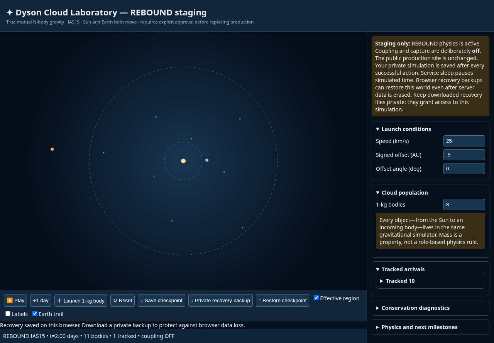
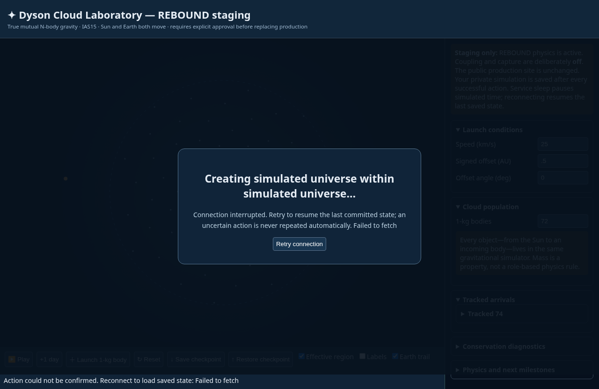
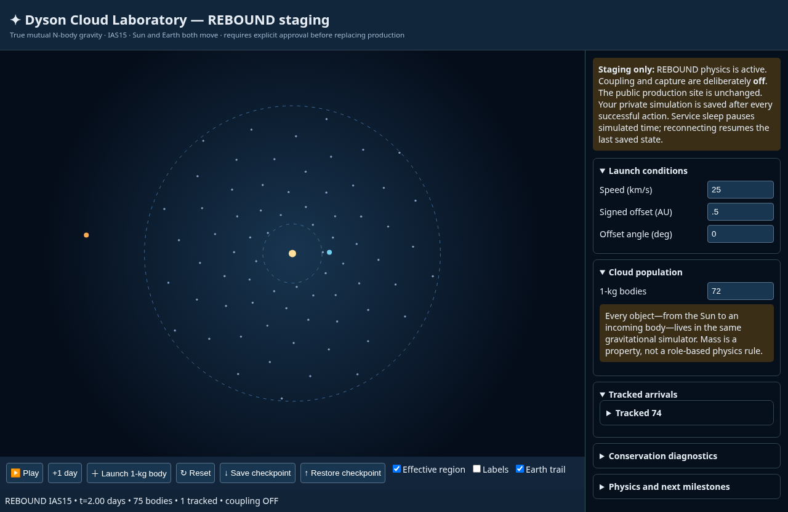

# Issue #3 verification evidence

## Follow-up: eight-cloud initialization and full host-loss recovery

The current revision fixes the underlying eight-cloud seed degeneracy and adds
browser-owned recovery to the same SQLite/session implementation in PR #4.
The initial implementation evidence below is historical; the eight-cloud and
host-loss limitations recorded there are superseded by this section and
[the current recovery contract](SESSIONS.md).

**Local result: 40/40 passed** — 10 REBOUND tests, 14 session/API tests,
8 complete-storage-loss/recovery tests and 8 automated Chromium tests.
A final Chromium rerun also checks that the recovered population input shows 8,
matching the actual restored cloud population. `git diff --check` and JavaScript
syntax validation passed. Tests ran with the same Python/REBOUND/Chromium versions
recorded below. No conservation tolerance was relaxed.

### Root-cause fix and numerical evidence

Previously, count=8 placed the first 1-kg cloud at Earth's exact coordinate;
its gravitational energy was non-finite. Scenario version 2 starts cloud phases
half a golden-angle step later. All 201 supported cloud populations (0–200) now
have distinct, finite initial states. Existing checkpoint coordinates remain
unchanged when restored; legacy metadata is supported.

| Check | Measured | Required |
| --- | --- | --- |
| Eight-cloud run, 364 days: relative energy drift | 2.176e-16 | <1e-8 |
| 12 complete host-loss recoveries: max position difference | 3.315e-15 AU | <1e-8 AU |
| 12 complete host-loss recoveries: max velocity difference | 9.966e-11 m/s | <1e-4 m/s |
| 12 complete host-loss recoveries: relative energy drift | 6.528e-16 | <1e-8 |
| Existing restart comparison: relative angular-momentum drift | 1.817e-16 | <1e-8 |
| Eight-cloud angular momentum, mass and linear momentum | Assertions passed | Original tolerances |

The full-host-loss continuation uses Sun + Earth + 8 clouds, starts at day 28,
and creates a new, empty SQLite database before each of 12 further 28-day
integrations. The reference integrates continuously from the same day-28 state.
Original energy baselines are retained, not zeroed at each recovery.

### Browser and safety evidence

- Two independent contexts launch, step, export/reset/restore and remain isolated.
- A real server SIGKILL with SQLite retained still recovers both users.
- Complete database deletion followed by backend recreation recovers A's
  eight-cloud + incoming-body world at day 2 and B's world at day 1.
- A's session cookie is also cleared; IndexedDB proves ownership independently.
- The database is deleted a second time. A downloaded private recovery file
  restores A in a completely clean browser; B recovers independently from its
  browser backup. Further stepping A leaves B unchanged.
- Forged/tampered capsules, wrong ownership credentials, wrong deployment keys,
  expired backups and missing keys fail safely. Capacity/quotas remain enforced.
- A deliberately failed IndexedDB write visibly reports NOT saved, retains the
  prior backup, and pauses. Retry saves the committed one-day state without
  advancing a second day. A late response cannot replace a newer backup.
- Missing deployment-key support is explicitly visible rather than claiming
  redeploy protection. Additive database migration also passed parallel startup.

Screenshots were visually inspected; they contain simulator UI only, without
recovery credentials or secret keys.

### Corrections during verification

The first follow-up browser run compared full responses across reset/restore,
including a deliberately incremented recovery revision. The corrected test
compares every physical field and checkpoint, and separately requires revision
advancement. The storage-failure test then exposed a Playwright test-driver issue:
returning the restored native `put` function from `evaluate` attempted an illegal
invocation. Returning no function fixed the test driver. The application catches
IndexedDB write failures and the final test confirms no page exceptions.
Screenshot review also caught the population input retaining its default 72 on
reload even when 8 clouds had recovered; startup/import now synchronize it.
No assertions were disabled or numerical tolerances weakened.

### Operator prerequisite and limits

Before an eventual approved deployment, securely configure and retain one
`DYSON_RECOVERY_KEY` across redeploys, and retain the browser backup or a downloaded
private recovery file. No paid service, account, production routing, hosting
configuration, or public deployment was created/changed. This is authenticated
state-only recovery, not a full IAS15 adaptive-history archive or an account-based
backup service. Browser/file/key loss and one-year capsule expiry remain explicit
limits. Private files contain a recovery credential and must not be shared publicly.

## Historical first implementation

Base: `foundation/rebound-ci` at `b6bee1b8dad0465916cc3ff06ef1219a0038b2cc`.
Implementation branch: `feat/issue-3-recoverable-sessions`.

Local environment: Python 3.12.14, REBOUND 4.6.0, pytest 9.1.1,
Playwright 1.64.1, installed Chromium 154.0.8037.57, Linux.
Dependencies installed into `/workspace/dyson-venv` because the system user
package directory is read-only. Browser download was blocked by network policy;
automated tests used the installed Chromium through Playwright, not mocked DOM.

## Baseline and repair evidence

- Baseline REBOUND: 7/7 passed.
- Baseline isolation reproduction: B had 2 bodies; A launched; B then had 3.
- Baseline browser: REBOUND interactions passed; static preview failed because
  managed Chromium blocks `file://`. Serving the unchanged preview over local
  HTTP preserves the assertions and matches how the app is deployed.
- First implementation run: 15/16 physics/API tests passed, 2/3 browser tests
  passed. API failure compared refreshed signature/expiry rather than physical
  state; its assertion now compares all physics/solver fields. Browser failure
  exposed Python/JavaScript JSON numeric spelling differences in HMAC input.
  Numeric canonicalization fixed the actual ownership-preserving UI restore.
- A targeted malformed-number probe found FastAPI's NaN validation-error
  serialization returned 500. Requests now reject non-finite/deep malformed JSON
  before parsing in the endpoint and use non-echoing validation responses.
- Repair verification: 19/19 physics/API and 3/3 browser tests passed. Subsequent
  hardening checks cover quota persistence, transaction failure and conservation.
  Final verification: **25/25 passed** (7 original REBOUND tests, 14 session/API tests, 4 Chromium tests; 9.83 seconds). No weakening of physical tolerances, disabling tests,
  force-model changes or unbounded repair loop was used.

## Measured continuation (364 simulated days)

Sun + Earth + 3 deterministic 1-kg cloud bodies. Save at day 28, then 12 times
recreate the app/store and integrate another 28 days. Compare against one live
reference integrator continued from the same day-28 state.

| Metric | Measured | Required |
| --- | --- | --- |
| Maximum position difference | 2.241e-15 AU | <1e-8 AU |
| Maximum velocity difference | 6.922e-11 m/s | <1e-4 m/s |
| Relative gravitational energy drift | 6.528e-16 | <1e-8 |
| Relative angular-momentum drift | 1.817e-16 | <1e-8 |
| Linear momentum / total mass | Assertion passed | <1e-8 m/s |
| Mass and elapsed time | Exact equality | Preserved |

Energy drift remains measured against the original scenario baseline, not a
new baseline at each reconstruction. These measurements are for this bounded
scenario and runtime, not all possible close encounters or chaotic trajectories.

## Browser evidence

Two independent cookie jars initialize distinct sessions, each launches, steps,
exports, resets and restores through the actual UI. Each rejects the other's
signed export. A real backend SIGKILL and recreation with the same SQLite file
retains A at 2 days and B at 1 day. Retrying the interrupted action reads committed
state without replaying a step. A later reset still leaves B unchanged. No page
JavaScript exceptions were observed.

These are simulator-only screenshots, without credentials or personal data.
CI produces fresh artifacts on each run. Live Render deployment and host-loss
recovery were not tested; no service was deployed or changed.

## Review and remaining limits

See [SESSIONS.md](SESSIONS.md) for storage survival, cookie ownership/expiry,
non-portable signed exports, serialized compute and ingress hardening limits.
The pre-existing coincident-body `cloud_count=8` scenario fails safely rather
than being silently clamped or changing the physics. There is no physics claim
for coupling/capture.

GitHub API access was denied by the environment proxy during development.
Do not treat configured CI jobs or local test results as proof of a GitHub CI run;
record actual CI URLs/outcomes only once accessible.
